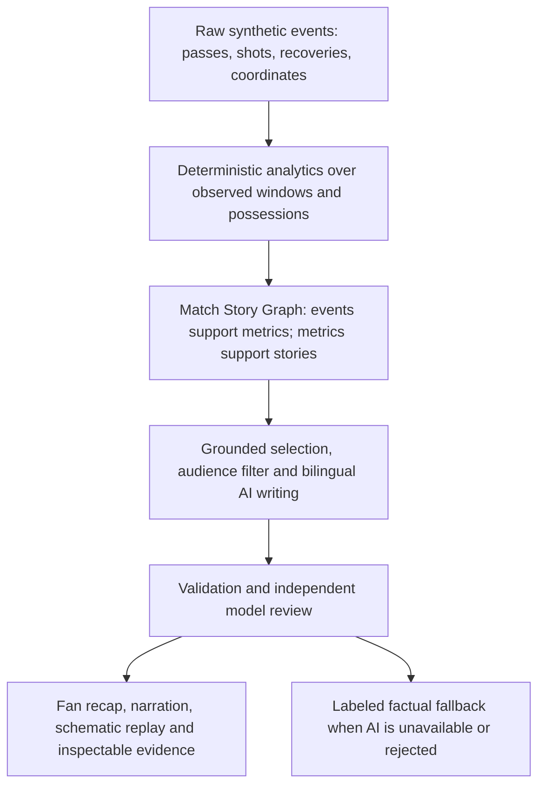

# MatchOS

**Missed the action? Understand what happened, what changed, and which match to follow next.**

MatchOS turns synthetic football events into an evidence-backed Catch Me Up recap. Follow a recorded goal build-up, listen in English or Spanish, and inspect the events behind a claim. Three matches advance together; Match Radar surfaces noteworthy action elsewhere using only events already observed.

Built for Inside the Game: Developer Hackathon. Independent prototype; no sponsorship or endorsement claimed. Club and reference player names identify actors in **fictional match action**, including fictional disciplinary incidents. Pitch replays are schematic, not video or continuous player tracking.

[Current documentation](docs/README.md) · [Submission package](docs/hackathon-submission.md) · [CI](https://github.com/plopez-4/matchos/actions/workflows/ci.yml) · [Patch notes](CHANGELOG.md)

## What the demo does

- **Catch Me Up:** a viewer cursor separates what happened during your absence from what changed in the match. Casual and Analyst perspectives use the same underlying facts.
- **Grounded AI:** optional Azure AI selects verified story IDs and writes the complete bilingual paragraph from structured observations. Local validation and a separate model review can reject it in favor of a clearly labeled factual fallback. The model review is fallible; accuracy is not guaranteed.
- **Recorded build-ups:** follow the recovery, completed team passes, shot and explicitly linked goal. The app does not infer an assist or connect a nearby goal by proximity alone.
- **Match Radar:** compare all three observed streams and open a relevant goal, chance or sending-off. This is a deterministic ranking, not a trained recommendation model or prediction.
- **Sending-off explanations:** recorded player, time and reason replace a pitch animation. A dismissal after full time is explicitly separate from the result and playing numbers.
- **Bilingual narration:** Automatic uses Azure when connected, with a matching installed device voice when unconfigured; Warm storyteller is the other visible choice. A failed cloud request does not silently switch providers.
- **Phone and development views:** compact fan layout, a separate evidence/analytics dashboard, and a fixed-case test hub.

## Core architecture



The FastAPI backend calculates facts; React/Vite presents them. Source event IDs, rule versions, possession links and shot-to-goal references remain inspectable. Azure receives structured evidence rather than a list of prewritten commentary lines. Rejected AI prose is replaced as a whole, not patched sentence by sentence.

## Twelve synthetic match versions

| Fixture                           | Versions | Starting players |
| --------------------------------- | -------: | ---------------- |
| Manchester United–Manchester City |        4 | 11 vs 11         |
| Crystal Palace–Newcastle United   |        4 | 11 vs 11         |
| Brighton–Fulham                   |        4 | 11 vs 11         |

New matchday independently selects one version per pairing: **64 possible combinations**, with three concurrent matches. Scores, participants, passing routes and activity patterns vary across authored versions. Switching fixtures preserves progress. During-match dismissals reduce the active side; post-match dismissals do not retrospectively change it.

Both experiences share the same [fixture manifest](backend/app/data/demo_fixtures.json), [version definitions](backend/app/data/match_variants.json) and backend generator. See [data provenance](docs/full-match-data.md) and [sending-off data](docs/sending-off-data.md). The nine exported JSONL evaluation feeds under `data/synthetic/` cover versions 1–3; the running generator and fixed test hub also include version 4.

## Run locally

Requirements: Python 3.11+, Node.js 22.12+, npm and Git. From Windows Command Prompt:

```cmd
git clone https://github.com/plopez-4/matchos.git
cd matchos
py -3 -m venv .venv
.venv\Scripts\python.exe -m pip install --upgrade pip==26.2.1
.venv\Scripts\python.exe -m pip install -c backend/constraints.txt -e ".\backend[dev]"
.venv\Scripts\python.exe -m uvicorn app.main:app --app-dir backend --host 127.0.0.1 --port 8000
```

Keep that window open. In a second CMD window, from the cloned `matchos` folder:

```cmd
cd frontend
npm ci
npm run dev -- --port 5173 --strictPort
```

| View                  | Local address                                                               |
| --------------------- | --------------------------------------------------------------------------- |
| Main fan page         | [127.0.0.1:5173](http://127.0.0.1:5173/)                                    |
| Fixed test cases      | [127.0.0.1:5173/testing.html](http://127.0.0.1:5173/testing.html)           |
| Development dashboard | [127.0.0.1:5173/?view=development](http://127.0.0.1:5173/?view=development) |

These links work on the computer running the app; they are not a public judging site. Without Azure configuration, recorded-event summaries still work. On macOS/Linux, use `python3 -m venv .venv` and `.venv/bin/python` in place of the Windows Python commands.

### Optional Azure AI and Speech

Replace the plain backend command with the private launcher, from the repository root:

```cmd
powershell -NoProfile -ExecutionPolicy Bypass -File ".\scripts\start_backend.ps1" -AI -Speech
```

Keys are entered through hidden local prompts and are not saved. Supply your own endpoint, deployment and region if different from the launcher's defaults. See [Azure AI setup](docs/azure-ai.md) and [Speech setup](docs/azure-narration.md). Never put keys in the frontend, repository or demonstration footage. Hosted Foundry Agent Service is not implemented; orchestration runs in the application.

### Try a repeatable demo

1. Open the **fixed test hub** and choose a fixture/version. This avoids random selection when checking a particular incident.
2. Start playback. Normal advances 30 match seconds roughly every 1.5 seconds; Fast does so roughly every 0.375 seconds, plus request time. Both are labeled accelerated synthetic replay.
3. Pause just after a listed goal, then request **Catch Me Up**. All three fixtures pause while the recap snapshot is taken. Inspect the AI/fallback label, EN/ES text and supporting events.
4. Open the named goal build-up, or view a sending-off explanation. Version 4 has Palace's card at 35:00, City's at 55:00, Fulham's at 60:00 and a losing Fulham player's dismissal after full time at 93:00.
5. Resume to continue all three matches. New matchday returns to random selection; backend restart clears in-memory sessions.

[Android/private-network instructions and checkpoints](docs/phone-and-fixed-testing.md). Phone access is optional and requires a reachable private network; the normal computer setup above needs no phone configuration.

## Verification and feedback

```cmd
.venv\Scripts\python.exe -m pytest backend/tests
.venv\Scripts\python.exe scripts/check_secrets.py
npm --prefix frontend run format:check
npm --prefix frontend test
npm --prefix frontend run build
```

The 25 October local release checks passed **597 backend tests and 72 frontend tests**, plus the production frontend build. CI separately checks formatting, credentials, dependencies and the container. Provider unit calls are mocked; automated checks do not establish live AI accuracy or pronunciation quality.

Ten screenshot-questionnaire submissions were reviewed on 25 October. They identified useful clarity issues, including finding Catch Me Up and expecting real video from a replay button. Those findings informed stronger action labels, clearer schematic-replay wording and factual sending-off details. This was screenshot comprehension feedback, not ten hands-on app sessions or evidence of engagement uplift. See [aggregated findings](docs/fan-study-oct24/findings.md).

Earlier [live recap audits](docs/recap-v23-nine-match-review-oct24.md) preserve real successes, rejected drafts and accepted errors. The current writer is `fan-narrative-v27-recorded-card-reasons`; earlier live results do not prove reliability across all twelve current versions. The owner has checked the latest computer/phone presentation; a fresh complete live AI matrix remains separate work.

## Submission status and limits

`main` is the canonical source to clone and submit. There is no confirmed public judging website or final public submission video yet. Publishing this repository does not complete the hackathon portal entry. See [submission materials and remaining work](docs/hackathon-submission.md).

The prototype uses bounded in-memory replay sessions and one backend worker. It has no real match feed, full-player tracking, production persistence or learned entertainment score. Azure usage is optional and subject to configured budgets, capacity and account billing. See [security controls](docs/security.md) and [deployment preparation](docs/judging-deployment.md).

## Code and license

Backend: `backend/app/` · frontend: `frontend/src/` · synthetic definitions: `backend/app/data/` · exported evaluation feeds: `data/synthetic/` · event contract: `schemas/` · tools: `scripts/`.

[MIT](LICENSE) covers application code. Photography, fonts and reference data have separate provenance in [visual assets](docs/visual-assets.md) and [full-match data](docs/full-match-data.md). Unlicensed Premier League and Microsoft logos have been removed; the broadcast theme does not imply endorsement. All match actions are fictional.
