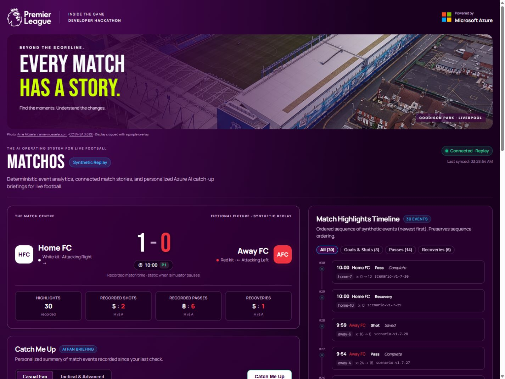

# MatchOS

## Matchday & Radar

Open **Matchday & Radar** to play three simultaneous synthetic fixtures on one shared clock. Radar can flag a developing match elsewhere, show its supporting shot/score evidence, stay quiet when activity fades, and open Catch Me Up in one click. This first version uses transparent rules; it does not predict excitement or claim measured engagement uplift. See [the milestone and scoring rules](docs/match-radar.md) and [Gemini review handoff](docs/gemini-match-radar-review.md).

## Security baseline

Browser replay advances server-owned synthetic events using a private HttpOnly session cookie. Arbitrary event ingestion is disabled unless a private backend token is configured. Requests and stored matches are bounded; Catch Me Up is cached, and optional Azure calls have an application budget with deterministic fallback. Production mode serves the built frontend, requires HTTPS, sets security headers and hides API documentation. Run one API worker. See [security setup and limits](docs/security.md).

## Full-match synthetic feeds

Try **United vs City** and **United vs Hull** in the scenario picker. Each covers two 45-minute halves plus three added minutes, using fictional players, connected possessions, sender/recipient passes, substitutions and a readable Catch Me Up briefing. Choose **80× Fast preview** for a short run. These are authored scenarios, not reconstructions of real games, and no model training is performed. See [full-match data and provenance](docs/full-match-data.md).

### The AI Operating System for Live Football

MatchOS turns a stream of football events into a match story fans can understand and verify. It connects recorded actions to emerging patterns, explains what changed, and helps returning viewers catch up without watching every missed minute.

Built for **Inside the Game: Developer Hackathon**, with synthetic football data, a React match experience, and an evidence-first path to Microsoft-powered AI.

[Explore the code](https://github.com/plopez-4/matchos) · [Latest dashboard](https://github.com/plopez-4/matchos/tree/feature/match-page-polish) · [Patch notes](CHANGELOG.md) · [Visual credits](docs/visual-assets.md)



## The broadcast experience

The current dashboard combines a purple-and-white Premier League-inspired theme, league artwork, a credited Goodison Park photograph and a Microsoft Azure technology label. Manrope and Bebas Neue fonts load locally.

Home FC wears white; Away FC wears red. Scores, recorded statistics, shot bars and timeline labels share those kit colors. A new score increase covers the scoreboard with **GOAL** in the scorer's color for six seconds, then returns to the score. First load and repeated unchanged polls do not replay old goals. Reduced-motion mode keeps the announcement without the wipe/zoom.

Catch Me Up displays **What happened** and **What changed**, with readable supporting events, actual response audience and actual AI mode. Evidence links reveal older or filtered-out timeline entries. Independent connection and Catch Me Up errors preserve a usable last result.

## What we're building

A fan joins a match late. The score tells them who is winning, but they still need context: what happened, how the game changed, and which developments deserve attention.

MatchOS brings those answers together:

| Feature                | What it gives the fan                                                                                              |
| ---------------------- | ------------------------------------------------------------------------------------------------------------------ |
| **Live match view**    | A score, event timeline and recorded match statistics that update during replay.                                   |
| **Match intelligence** | Reproducible comparisons that reveal changes in recorded activity.                                                 |
| **Match Story Graph**  | Connections from events to calculated patterns to explanations, with inspectable evidence.                         |
| **Catch Me Up**        | A summary of events and stories since the viewer's last check.                                                     |
| **Personalization**    | Casual or advanced explanations built from the same underlying facts.                                              |
| **Evidence-backed AI** | An agent retrieves trusted stories and chooses what to explain; the app checks the selection before displaying it. |

Our first audience is football fans. The longer-term goal is to make the same intelligence useful to broadcasters, studios and streaming experiences.

## See the match stories

MatchOS includes a catalog of selectable synthetic scenarios to demonstrate distinct match flows:

- **Pressure Builds (`pressure-builds`)**: Sustained Home attacking pressure with high defensive recoveries, progressive passes, mounting shots, and a late breakthrough (Home 1–0, 33 events).
- **Comeback (`comeback`)**: An early Home goal followed by Away resilience, rapid transitions from high recoveries into shots, and a late equalizer (1–1, 34 events).
- **Quiet Match (`quiet-match`)**: A tense midfield tactical battle with careful passing and restrained shooting; demonstrates that Catch Me Up exercises restraint and does not hallucinate false patterns (0–0, 30 events).
- **Legacy Default (`legacy-default`)**: The original 10-minute highlights scenario preserved for backward compatibility (Home 1–0, 30 events).

At the end of a scenario, MatchOS can explain:

> Home recorded 4 shots in minutes 5–10, compared with 1 in the previous five minutes.
> Home won 3 recoveries in the attacking third in minutes 5–10.
> Away completed a rapid transition: shot recorded 23 seconds after winning possession.

Open **Inspect supporting events** to examine the exact event sequence behind any statement. Then select **Catch Me Up**:

> Recorded events since your last check: 33. Goals: 1. Home scored at 9:31. Home recorded 4 shots in minutes 5–10, compared with 1 in the previous five minutes. Home won 3 recoveries in the attacking third in minutes 5–10.

Request it again without new events and the summary reports zero new events. The viewer cursor advances only after a successful response.

All comparisons describe recorded event facts according to deterministic, versioned rules. They do not claim tactical omniscience or subjective intent.

## Development status

**This is an actively developed hackathon prototype.** Features are being reviewed in pull requests before integration.

| Location                                                                                                                                                              | What's available                                                                                                                                                                               |
| --------------------------------------------------------------------------------------------------------------------------------------------------------------------- | ---------------------------------------------------------------------------------------------------------------------------------------------------------------------------------------------- |
| `main` / `develop`                                                                                                                                                    | Initial FastAPI and React foundation, synthetic replay, count analytics and basic Catch Me Up.                                                                                                 |
| [`feature/evidence-backed-stories`](https://github.com/plopez-4/matchos/tree/feature/evidence-backed-stories) · [PR #1](https://github.com/plopez-4/matchos/pull/1)   | Scripted highlights, five-minute shot comparisons, event/metric/story support graph, readable evidence and richer Catch Me Up. Backend and frontend GitHub checks passed.                      |
| [`feature/grounded-ai-explanations`](https://github.com/plopez-4/matchos/tree/feature/grounded-ai-explanations) · [PR #2](https://github.com/plopez-4/matchos/pull/2) | Optional Azure-backed tool flow for story selection, validation, execution trace and deterministic fallback. Live Azure calls verified for casual and advanced summaries.                      |
| [`feature/match-page-polish`](https://github.com/plopez-4/matchos/tree/feature/match-page-polish) · [PR #3](https://github.com/plopez-4/matchos/pull/3)               | Latest broadcast dashboard, kit colors, goal takeovers, fresh replay sessions, evidence navigation and request-state fixes.                                                                    |
| `feature/richer-scenarios-and-stories`                                                                                                                                | Selectable scenarios (`pressure-builds`, `comeback`, `quiet-match`), browser scenario selector, CLI `--scenario` flag, and 3 new rules (`high-recovery`, `progressive-pass`, `recovery-shot`). |

The AI adapter is off by default. It uses a Microsoft Foundry Azure OpenAI-compatible model endpoint. The model selects supported story IDs; trusted text is rendered by the app. Free-form AI narration and hosted Foundry Agent Service deployment are future work.

## How MatchOS works

```text
Synthetic football events
          |
          v
Validated ingestion and ordered event storage
          |
          v
Deterministic counts and time-window analytics
          |
          v
Match Story Graph: events -> metrics -> stories
          |
          v
Evidence retrieval and validated AI story selection
          |
          v
Live match cards + personalized Catch Me Up
```

The intelligence layer calculates the facts. Story nodes retain supporting event IDs and versioned rules. The optional AI layer retrieves these candidates and selects their order for the audience. Invalid selections or provider failures fall back to the deterministic summary.

## Try the working demo

**Requirements:** Python 3.11+, Node.js 22.12+, npm and Git. If Windows cannot find `python`, try the Python launcher `py` after installing Python.

Clone the latest working dashboard branch while the stacked changes are under review:

```powershell
git clone --branch feature/match-page-polish https://github.com/plopez-4/matchos.git
cd matchos
```

### 1. Backend terminal

From the repository root:

```powershell
py -3 -m venv .venv
.\.venv\Scripts\python.exe -m pip install --upgrade pip==26.2.1
.\.venv\Scripts\python.exe -m pip install -c backend/constraints.txt -e "./backend[dev]"
.\.venv\Scripts\python.exe -m uvicorn app.main:app --app-dir backend --reload
```

Open the [API explorer](http://localhost:8000/docs). Keep this terminal running.

### 2. Frontend terminal

Open a second terminal in the repository root:

```powershell
cd frontend
npm.cmd ci
npm.cmd run dev
```

Open the address Vite prints, normally [MatchOS](http://127.0.0.1:5173). If that port is occupied it may choose another. Keep this terminal running too.

#### 3. Play from the website

Use the **Scenario** selector to choose between `pressure-builds`, `comeback`, `quiet-match`, or `legacy-default`.

Use **Start replay**, **Pause / Resume**, **Speed** (0.5×–4×), and **Reset** in the match page. Normal speed sends one highlight every three seconds. Keep the page open while playback runs. Reset opens a new match at 0–0 and clears its Catch Me Up cursor and evidence selection; earlier matches remain available at their own URLs. The scenario choice can also be set directly in the URL query string (e.g. `?scenario=comeback`). Opening an existing match offers **Start new replay**.

The browser reserves a server-owned fixture through `POST /api/replay/start` and advances it by sequence with a private session cookie. It cannot submit fabricated event facts. Playback stops when the page closes or reloads. A request already sent at pause may still be accepted; retrying that event is safe. The displayed match data follows polling and can lag the replay progress briefly. Earlier matches expire after four hours.

### Optional simulator terminal

Open a third terminal in the repository root:

```powershell
.\.venv\Scripts\python.exe simulator/run.py --scenario pressure-builds --interval 3 --match-id cli-pressure-1
```

You can choose any available scenario (`pressure-builds`, `comeback`, `quiet-match`, `legacy-default`):

```powershell
# Replay the Away comeback scenario
.\.venv\Scripts\python.exe simulator/run.py --scenario comeback --interval 2 --match-id cli-comeback-1

# Replay the restrained tactical midfield battle
.\.venv\Scripts\python.exe simulator/run.py --scenario quiet-match --interval 1 --match-id cli-quiet-1
```

Use a fresh CLI match ID for each run. Open the frontend with `?match=cli-pressure-1&scenario=pressure-builds` (or your chosen ID/scenario) to watch; the simulator owns advancement of that replay. Events arrive at the specified interval. Watch the GOAL takeover, score updates and story badges. Inspect evidence and try Catch Me Up. Use `--interval 0.5` for a faster run.

On macOS/Linux, replace `.\.venv\Scripts\python.exe` with `.venv/bin/python`, use `python3 -m venv .venv`, and use `npm` instead of `npm.cmd`.

**Replay notes:** all scenarios are strictly synthetic highlights fixtures with fictional teams and players, not real match feeds. Replaying the same match ID does not duplicate events. Restarting the backend clears all matches.

For a fresh replay without interrupting the Azure connection, open `http://127.0.0.1:5173/?match=replay-02&scenario=comeback` before running:

```powershell
.\.venv\Scripts\python.exe simulator/run.py --scenario comeback --interval 3 --match-id replay-02
```

Use a new ID each time and the actual frontend port. Match IDs in the UI accept letters, numbers, underscores and hyphens, up to 80 characters. Without a valid query, the UI displays `demo-match`. Reload resets the viewer cursor, not backend events.

For Azure story selection, follow the [Azure configuration guide](docs/azure-ai.md). The working deployment is `matchos-explainer`, using Azure-hosted `gpt-4.1-mini`. Credentials stay on the backend; never commit keys or place them in React/VITE variables. An unconfigured clone remains usable with deterministic summaries.

## Technology and repository

| Area                  | Technology / location                                                                     |
| --------------------- | ----------------------------------------------------------------------------------------- |
| Backend               | Python, FastAPI, Pydantic · `backend/app/`                                                |
| Frontend              | React, Vite · `frontend/src/`                                                             |
| Synthetic data        | Seeded Python scenario catalog · `simulator/`, `backend/app/simulation.py`                |
| Shared contract       | Versioned JSON Schema · `schemas/`                                                        |
| Verification          | pytest, mocked provider tests, frontend builds, GitHub Actions                            |
| Microsoft integration | Working Azure OpenAI-compatible Foundry model endpoint; optional verified story selection |
| Documentation         | Product, architecture, API, milestone and submission plans · `docs/`                      |

### Run checks

From the repository root, with backend dependencies installed:

```powershell
.\.venv\Scripts\python.exe -m pytest backend/tests
cd frontend
npm run format:check
npm test
npm run build
```

Latest local validation: **39 backend tests, 19 frontend tests, and a successful production build**. Frontend regression tests use production state/scorer/timeline logic. Browser checks verified live Azure Casual/Advanced summaries, hidden evidence navigation, mobile layout, asset loading, kit colors and a red-team goal takeover in an isolated synthetic test. Mock tests do not require Azure credentials. Check the current GitHub Actions run before claiming hosted CI passed.

## What we're working on next

- Integrate the stacked pull requests and verify clean-clone setup.
- Expand synthetic match realism and support more evidence-backed patterns.
- Persist events, story history and viewer preferences.
- Rehearse the polished fan experience and prepare a functioning demo under two minutes.
- Confirm category-specific hero technologies and remaining submission requirements.

Current storage is in memory and resets on restart. The backend supports one process, and the graph is computed from current events rather than persisted history. Authentication, bounded queries and deployment controls remain future work.

## Team workflow

Use `develop` for integration and `main` for tested releases. Create feature branches, keep changes focused, and submit pull requests with demo steps and verification. Backend/integration, frontend, and intelligence/AI are the main ownership areas.

See [CONTRIBUTING](CONTRIBUTING.md), the [milestone plan](docs/milestone-1.md), and the [initial task drafts](docs/github-issues.md).

Shared code style is enforced in CI with [Prettier](https://prettier.io/docs/install). Run `npm.cmd --prefix frontend run format` from the repository root to apply it, or `npm.cmd --prefix frontend run format:check` to check it. See CONTRIBUTING for the supported files and editor setup.

## License

[MIT](LICENSE) for application code. Third-party artwork, photography and fonts have separate terms in [visual-assets.md](docs/visual-assets.md); photograph attribution is visible in the UI. League/Microsoft marks remain their owners' property; no endorsement is claimed. All demo teams, players and match events are fictional. No real Premier League match data is included.
