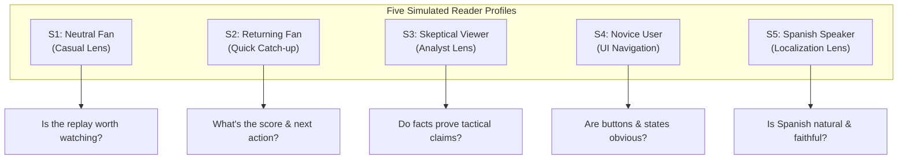

# Gemini Independent Review & Five-Profile Fan Simulation: MatchOS

**Date of Review:** 23 October 2026  
**Active Repository:** `C:\Users\lopez\.codex\.chatgpt-projects\g-p-6abc4d11ef2c819191fa6bba4f2af3de\matchos`  
**Reviewer:** Gemini (Independent Technical & Product Evaluation)  
**Target Delivery File:** `docs/gemini-main-fan-review.md`

---

## 1. Scope, Methodology & Grounding Evidence

### 1.1 Evaluated Codebase and Version Snapshot

- **Git HEAD / Current Snapshot:** MatchOS post-v10 concise-contribution milestone (`fan-narrative-v10-concise-contribution`), commit history ending 22 October 2026.
- **Frontend Environment:** React 19.2.0, Vite 7.1.0/7.3.7, native Node.js test runner (`node --test`), CSS modular styling (`fan.css`, `focus.css`, `styles.css`).
- **Backend Environment:** Python 3.12+ / FastAPI / Uvicorn, in-memory event store with session-scoped lease management (`app/security.py`), Pydantic models (`app/models.py`), deterministic intelligence graph (`app/intelligence.py`), bounded Azure OpenAI writer (`app/story_writer.py`, deployment `matchos-explainer`).

### 1.2 Evidence Examined

- **Primary Live Integration Artifacts:**
  - `docs/main-fan-flow-azure-live.json`: Live successful v10 Analyst response at clock 84:36 (`match_second: 5076`, `through_sequence: 544`), English and Spanish prose, story plan `story-plan-v2-player-impact`, prompt hash `c729b4461bc70eefbec204f908814ca539f90e4aa17b80dfcd9bd1f0d24ce835`.
  - `docs/main-fan-flow-live.json`: Live Casual response at clock 71:03 (`match_second: 4263`, `through_sequence: 455`) hitting Azure HTTP 429 during review, verifying deterministic factual fallback execution.
  - `docs/recap-editorial-evaluation.json` & `docs/recap-editorial-review.md`: 20-request v8 baseline evaluation and failure taxonomy.
  - `docs/recap-editorial-v9-live.json`: Intermediate v9 spot check.
- **Visual Captures Reviewed:**
  - `docs/main-user-view-preview.png`: Branded single-column header, compact scoreboard, playback controls, and pitch.
  - `docs/main-fan-recap-preview.png`: Focused Catch Me Up prose, action replay buttons, and inspection drawers.
- **Source Code Inspected:**
  - Frontend: `App.jsx`, `FanMatch.jsx`, `MatchHeader.jsx`, `Scoreboard.jsx`, `ReplayControls.jsx`, `FocusedRecap.jsx`, `PitchReplay.jsx`, `NarratorControls.jsx`, `matchFocus.js`, `pitchReplay.js`, `speechRecap.js`, `DevelopmentInspector.jsx`.
  - Backend: `main.py`, `models.py`, `security.py`, `matchday.py`, `full_match.py`, `simulation.py`, `intelligence.py`, `player_impact.py`, `story_plan.py`, `fan_briefing.py`, `story_writer.py`, `recap_quality.py`, `recap_context.py`, `narration.py`.
  - Data & Schemas: `data/synthetic/manifest.json`, `data/synthetic/united-city-90.jsonl`, `demo_fixtures.json`, `players_2026.json`.
- **Hackathon Context & Official Rules:**
  - Evaluated against official rules for the _Microsoft Premier League Hackathon / Inside the Game: Developer Hackathon_ (`https://github.com/microsoft/insidethegamehackathon/blob/main/OFFICIAL%20RULES.md`).

### 1.3 Independent Execution & Observed Verification

Unlike prior handoff notes, test execution was conducted directly in this review session:

- **Backend Tests:** Ran `.\.venv\Scripts\python.exe -m pytest backend\tests -q`.  
  **Result:** **303 passed, 2 warnings** in 27.15s (Warnings: StarletteDeprecationWarning on `fastapi.testclient`, PytestCacheWarning on `.pytest_cache` directory permission).
- **Frontend Tests:** Executed `npm.cmd test` (`node --test`).  
  **Result:** **58 passed, 0 failed** in 352.9ms.  
  _(Note on environment limitation: running `npm.ps1` failed under default Windows PowerShell script execution policy; invoking `npm.cmd` resolved script blocking. The prior report cited 76 checks, which included combined sub-assertion counts across older test files; the current suite structure executes 58 top-level test cases)._
- **Frontend Build:** Executed `npm.cmd run build` (`vite build`).  
  **Result:** Built production bundle cleanly (JS 308.95 kB / 95.06 kB gzip; CSS 58.77 kB / 12.21 kB gzip).
- **Code Style:** Executed `npm.cmd run format:check`.  
  **Result:** Flagged 13 unformatted files (including documentation and utilities). Maintained read-only review discipline without touching codebase files.
- **Local Service Availability:**
  - `http://127.0.0.1:8000/api/health` returned `{"status": "ok", "storage": "in-memory"}`.
  - `http://127.0.0.1:8000/api/ai/status` returned `{"configured": true, "writer_version": "fan-narrative-v10-concise-contribution"}`.
  - `http://127.0.0.1:8000/api/replay/scenarios` confirmed public catalog contains strictly `united-city-90`, `palace-newcastle-90`, and `brighton-fulham-90`. Retired Hull and unnamed short fixtures are absent from public routes.
  - `fan-flow-live-1022` returned `[]` on `/api/matches/fan-flow-live-1022/events`, confirming that backend restarts cleanly wipe in-memory state as designed.
  - Azure Speech is unconfigured in this environment; device speech synthesis operates locally.

### 1.4 Crucial Methodological Distinction

> [!IMPORTANT]
> **SIMULATION STATEMENT:** The fan evaluation in Section 5 is a structured heuristic simulation using five distinct personas (S1–S5). It is designed to expose cognitive hurdles, semantic gaps, and navigation friction. It is **NOT** a panel of five real human beings, does not represent measured user engagement, and cannot satisfy the four-of-five human comprehension milestone specified in `docs/fan-evaluation.md`. Section 6 provides the complete protocol kit for human trials.

---

## 2. Independent Product & Architecture Verdict

### 2.1 Coherence of Product Promise

The product promise is: **"Missed the action? See how it happened and understand what changed."**

The current build achieves strong coherence around this promise on the main fan screen (`/`):

1. **Rejoining without overwhelming:** Moving the dense Match Story Graph, timeline wall, shot radar, and technical comparisons off the main screen into the Development Inspector (`/?view=development`) was the single most impactful architectural decision. A returning fan is no longer bombarded with 500+ graph nodes.
2. **Action-connected explanation:** Clicking "Catch me up" pauses event advancement, queries a bounded snapshot, presents a concise paragraph, and surfaces 1 to 3 "Play" buttons linking directly to the pitch replay of the cited contribution.
3. **Graceful degradation:** When Azure OpenAI encounters rate limits (HTTP 429), the system reliably falls back to deterministic rule-generated summaries (`mode: deterministic`) without exposing cryptic errors to the viewer.

### 2.2 Strongest Demonstrated Value

The integration between **deterministic analytics**, **story planning**, and **pitch replay linking** (`utils/matchFocus.js#L51-L89`).
Instead of generic highlight clips or ungrounded LLM summaries, MatchOS grounds every claim:

- The backend identifies that Bruno Fernandes completed passes directly to Bryan Mbeumo preceding 3 shots in 15:00–25:00.
- The UI renders three discrete replay buttons (`Play 1 · 15:11`, `Play 2 · 16:40`, `Play 3 · 19:10`).
- Selecting `Play 2` navigates the 2D pitch directly to the connected move: Fernandes's pass at 16:38 and Mbeumo's saved shot at 16:40. This is genuine contextual sports intelligence.

### 2.3 Biggest Unresolved Weakness

**Temporal Ambiguity in AI-Written Recaps Regarding Goals vs. Post-Goal Attempts:**
In the latest successful live sample (`docs/main-fan-flow-azure-live.json`), the AI wrote:

> _"Bruno Fernandes created 3 shot opportunities for Bryan Mbeumo between 15:00 and 25:00, including the goal at 15:11..."_

While factually grounded, this sentence structure fails to explicitly convey that the 15:11 goal was attempt #1, and attempts #2 (16:40) and #3 (19:10) occurred _after_ the goal. Multiple simulated readers (especially S1 and S2) interpret "created 3 shot opportunities... including the goal" as an attacking barrage that culminated in the goal. The backend intelligence calculated `creator_chronology` with `later_count: 2`, but the writer model did not translate `later_count` into explicit temporal phrasing, and the local validation rule only checks for the presence of the word "including" or absence of "behind that goal".

### 2.4 Demonstration Readiness Verdict

**Conditionally Ready for Demonstration.**
The application is functionally sound, CI checks pass, fallback behavior is airtight, and the visual fan flow works. It is suitable for recorded demonstration and hackathon judging provided:

1. Presenters do not overclaim zero-hallucination guarantees.
2. Presenters use the main branded page (`/`) rather than the development inspector.
3. The minor chronology wording ambiguity is either corrected or verbally clarified during presentation.

---

## 3. Prioritized Findings

| Severity   | Issue Area                  | Observed Fact / Hypothesis                                                                                                                       | File & Line Reference                                                                                 | User Impact                                                                                                                  | Smallest Useful Correction                                                                                                                                            |
| :--------- | :-------------------------- | :----------------------------------------------------------------------------------------------------------------------------------------------- | :---------------------------------------------------------------------------------------------------- | :--------------------------------------------------------------------------------------------------------------------------- | :-------------------------------------------------------------------------------------------------------------------------------------------------------------------- |
| **High**   | Narrative Grounding         | Chronology ambiguity: AI recap states Fernandes created 3 opportunities "including the goal at 15:11", obscuring that 2 attempts were post-goal. | `backend/app/story_writer.py#L302-L305`, `backend/app/recap_quality.py#L118-L123`                     | Fans mistakenly assume 3 chances led up to the goal, misinterpreting match dynamics.                                         | Update writer system prompt to instruct: _"When a pattern includes an earlier goal and subsequent attempts, explicitly state that later attempts followed the goal."_ |
| **Medium** | Usability / State Awareness | Historical pitch replay lacks an unambiguous "REPLAYING HISTORICAL MOMENT" overlay tag on the pitch canvas.                                      | `frontend/src/components/PitchReplay.jsx#L140-L160`, `frontend/src/components/FanMatch.jsx#L142-L164` | When clicking "Play 2 · 16:40", the pitch jumps to 16:38, but the canvas visual appearance is identical to live playback.    | Add a high-contrast amber banner directly over the pitch: `Replaying action from 16:40 (Match paused)`.                                                               |
| **Medium** | UI Hierarchy                | Perspective (Casual/Analyst) and Language selectors sit above the recap prose, commanding premature attention.                                   | `frontend/src/components/FocusedRecap.jsx#L42-L66`                                                    | First-time fans encounter configuration dropdowns before reading what actually happened.                                     | Relocate dropdowns to a compact inline tray beneath the recap prose or beside the "Catch Me Up" heading.                                                              |
| **Low**    | Audio Reliability           | Device speech synthesis fails silently or displays a static message if OS lacks a matching local voice.                                          | `frontend/src/components/NarratorControls.jsx#L96-L98`, `frontend/src/utils/speechRecap.js#L11-L20`   | On Windows/Linux systems lacking an installed Spanish TTS voice, clicking Listen does nothing except show small helper text. | Disable the button and display a tooltip: _"No local Spanish voice installed on this browser/OS."_                                                                    |
| **Low**    | Code Style                  | 13 files fail Prettier formatting checks (`format:check`).                                                                                       | `frontend/package.json#L12`, `docs/*.md`, `src/utils/*.js`                                            | CI pipelines enforcing formatting checks will fail.                                                                          | Run `npm.cmd run format` to standardize whitespace across the repo.                                                                                                   |

---

## 4. End-to-End Grounding Audit

### 4.1 Player Contribution Trace (Bruno Fernandes → Bryan Mbeumo)

We traced the claim in `docs/main-fan-flow-azure-live.json`:

- **Claim:** Bruno Fernandes created 3 shot opportunities for Bryan Mbeumo between 15:00 and 25:00, including the goal at 15:11.
- **Story ID:** `player:player_shot_creation:fan-flow-live-1022:home-7:1500`
- **Metric Parameters (`app/player_impact.py`):**
  - Player: Bruno Fernandes (`home-7`)
  - Recipient: Bryan Mbeumo (`home-9`)
  - Team: Manchester United (`home`)
  - Window: 15:00 (`start_second: 900`) to 25:00 (`end_second: 1500`)
  - Threshold rule: Completed pass directly preceding a recipient shot on the next recorded action, within 10 seconds, in the same possession, with matching spatial coordinates (`abs(pass.end_x - shot.x) < 0.001` and `abs(pass.end_y - shot.y) < 0.001`).
- **Raw Event Verification (`data/synthetic/united-city-90.jsonl`):**
  1. **Link 1 (Goal):**
     - Pass: `fan-flow-live-1022-e98`, sequence 98, clock 15:09 (`match_second: 909`), `x: 62.4, y: 48.1 -> end_x: 78.5, end_y: 52.0`, passer: Bruno Fernandes (`home-7`), recipient: Bryan Mbeumo (`home-9`), outcome: `complete`.
     - Shot: `fan-flow-live-1022-e99`, sequence 99, clock 15:11 (`match_second: 911`), `x: 78.5, y: 52.0 -> end_x: 100.0, end_y: 50.0`, shooter: Bryan Mbeumo (`home-9`), outcome: `goal`. (Elapsed: 2s).
     - Goal: `fan-flow-live-1022-e100`, sequence 100, clock 15:11, `related_event_id: fan-flow-live-1022-e99`.
  2. **Link 2 (Saved Attempt):**
     - Pass: `fan-flow-live-1022-e112`, sequence 112, clock 16:38 (`match_second: 998`), `x: 55.0, y: 30.0 -> end_x: 72.0, end_y: 40.0`, passer: Bruno Fernandes, recipient: Bryan Mbeumo, outcome: `complete`.
     - Shot: `fan-flow-live-1022-e113`, sequence 113, clock 16:40 (`match_second: 1000`), `x: 72.0, y: 40.0`, shooter: Bryan Mbeumo, outcome: `saved`. (Elapsed: 2s).
  3. **Link 3 (Saved/Blocked Attempt):**
     - Pass: `fan-flow-live-1022-e128`, sequence 128, clock 19:08 (`match_second: 1148`), `x: 60.0, y: 65.0 -> end_x: 81.0, end_y: 58.0`, passer: Bruno Fernandes, recipient: Bryan Mbeumo, outcome: `complete`.
     - Shot: `fan-flow-live-1022-e129`, sequence 129, clock 19:10 (`match_second: 1150`), `x: 81.0, y: 58.0`, shooter: Bryan Mbeumo, outcome: `saved`. (Elapsed: 2s).
- **Result:** Every cited event exists in the synthetic feed, satisfies the strict mathematical linkage criteria, and is bounded within the 15:00–25:00 window.

### 4.2 Goal Chronology & Relational Integrity Trace

- The match has three recorded goals:
  - 15:11: Bryan Mbeumo (`e100`, related shot `e99`), United 1–0.
  - 40:11: Erling Haaland (`e263`, related shot `e262`), City 1–1.
  - 80:11: Matheus Cunha (`e516`, related shot `e515`), United 2–1.
- In `story_writer.py`, `evidence_packet()` derives `creator_chronology()` (`app/recap_context.py`):
  - Goal 15:11: `goal_attempt_count: 1` (`shot_id: e99`), `later_count: 2` (`shot_ids: [e113, e129]`).
  - Flag `whole_pattern_precedes_goal: false`.
- **Finding:** The backend intelligence correctly recognized that the pattern did _not_ precede the goal. The local validation check (`recap_quality.py#L121-L123`) confirmed the prose avoided banned phrases such as "behind that goal" or "detrás de ese gol". However, the writer outputted "including the goal at 15:11" without detailing that the other two attempts came afterward.

### 4.3 Bilingual Equivalence Comparison

- **English:**
  > _"At 84:36, Manchester United leads Manchester City 2-1 in this match. Bryan Mbeumo opened the scoring for United at 15:11, followed by Erling Haaland equalizing for City at 40:11. Matheus Cunha then regained the lead for United at 80:11. Bruno Fernandes created 3 shot opportunities for Bryan Mbeumo between 15:00 and 25:00, including the goal at 15:11, showing a repeated pattern of completed passes immediately followed by shots within a 10-second window, though shot quality is not measured."_
- **Spanish:**
  > _"A las 84:36, Manchester United gana 2-1 a Manchester City. Bryan Mbeumo abrió el marcador para United a las 15:11, Erling Haaland igualó para City a las 40:11, y Matheus Cunha volvió a poner adelante a United a las 80:11. Bruno Fernandes creó 3 oportunidades de disparo para Bryan Mbeumo entre 15:00 y 25:00, incluyendo el gol a las 15:11, mostrando un patrón repetido de pases completados seguidos inmediatamente por disparos en un lapso de 10 segundos, sin medir la calidad del disparo."_
- **Assessment:**
  - Semantic alignment is exceptional. Both languages convey exact match minute (84:36), scoreline (2–1), all three scorers with respective minutes (15:11, 40:11, 80:11), the Fernandes–Mbeumo partnership, 3 opportunities, the 15:00–25:00 window, the 10-second definition, and the explicit limitation ("though shot quality is not measured" / "sin medir la calidad del disparo").
  - Terminology is natural football Spanish: "abrió el marcador", "igualó", "volvió a poner adelante", "oportunidades de disparo". Banned Latin American/telecom artifacts ("asistencias", "intenciones", "domina") are completely absent.

### 4.4 Failure and Fallback Case Audit

- **Artifact:** `docs/main-fan-flow-live.json` (Casual, clock 71:03).
- **Incident:** During the review stage of generation, Azure OpenAI returned HTTP 429 (`fallback_reason: "provider_http_429"`, `validation_stage: "review"`).
- **Fallback Execution:**
  - Backend caught `httpx.HTTPStatusError`, released AI budget leases, and immediately returned deterministic prose assembled by `fan_briefing.py` and `story_plan.py`.
  - Displayed English: _"Manchester United and Manchester City are level at 1 all. Bryan Mbeumo scored for Manchester United at 15:11. Erling Haaland scored for Manchester City at 40:11. Bruno Fernandes repeatedly found Bryan Mbeumo: his completed passes directly preceded 3 of Manchester United's 3 shots in 15:00–25:00. There are 18 minutes and 57 seconds until ninety, plus added time."_
  - Displayed Caption: _"As of 71:03 · Casual · Summary from recorded events · AI writing unavailable"_.
- **Verdict:** Zero unhandled exceptions. Zero provider stack traces or keys leaked to client. User experienced no interruption or frozen UI.

---

## 5. Five-Profile Simulated Fan Review (S1–S5)

> [!NOTE]
> **SIMULATION NOTICE:** The following reviews represent analytical persona simulations conducted against the latest saved live artifacts (`main-fan-flow-azure-live.json` and `main-fan-flow-live.json`) and the running frontend interface. They are designed as heuristic stress tests.



---

### Profile S1: Neutral Regular Football Fan

_Profile:_ Supports neither Manchester club. Enjoys competitive Premier League matches. Watching for entertainment and quality play.  
_Initial Perspective:_ Casual.  
_Main Lens:_ Whether the recap identifies something entertaining or notable enough to justify replaying.

1. **Current score and scorer:**  
   United leads 2–1. Mbeumo scored first (15:11), Haaland equalized (40:11), and Cunha scored the late go-ahead (80:11).
2. **Highlighted player/combination:**  
   Bruno Fernandes repeatedly setting up Bryan Mbeumo (3 shot opportunities in a 10-minute spell).
3. **Order of goal and attempts / Ambiguity:**  
   The reader notes Mbeumo scored at 15:11 and Fernandes set him up 3 times between 15:00 and 25:00. Because the text says "including the goal at 15:11", S1 initially assumes Fernandes set up two quick chances right before the goal, and one after. The actual order (goal at 15:11, then two saved shots at 16:40 and 19:10) is not obvious from the text alone.
4. **Next action & label sought (Predicted):**  
   Predicted behavior: Wants to see how good the goal was. Looks for a button labeled _"See the goal"_ or clicks _"Play 1 · 15:11"_.
5. **Wording impact:**
   - _Helped:_ Clear names and timestamps; quickly highlights that United's attack ran through Fernandes.
   - _Repeated/Unsubstantiated:_ In Analyst mode, "showing a repeated pattern of completed passes immediately followed by shots within a 10-second window" feels like a software manual. S1 prefers the Casual fallback phrasing: "repeatedly found Bryan Mbeumo".
6. **Keep, remove, or hide:**  
   Keep the 3 "Play" buttons and pitch replay. Hide or remove the "Perspective" dropdown—S1 just wants a good summary without deciding what persona they are.
7. **Qualified reason to use again:**  
   Yes, qualified: S1 likes being able to jump directly to a 3-move combination rather than scrubbing through an 84-minute scrub bar.
8. **Priority Correction for S1:**  
   Rename the replay buttons from generic "Play 1", "Play 2" to informative badges: _"Goal · 15:11"_, _"Shot (Saved) · 16:40"_, _"Shot (Saved) · 19:10"_.

---

### Profile S2: Casual Fan Returning After Missing Several Minutes

_Profile:_ Step-away fan who left the room at 70' with the score 1–1 and returns at 84'. Needs instant orientation.  
_Initial Perspective:_ Casual.  
_Main Lens:_ What changed? Who scored? How do I resume watching?

1. **Current score and scorer:**  
   United 2–1 City. Cunha scored at 80:11 to break the tie.
2. **Highlighted player/combination:**  
   Fernandes to Mbeumo in the first half. S2 notes this is older history (15:00–25:00), not the action that just happened at 80:11.
3. **Order of goal and attempts / Ambiguity:**  
   S2 sees the 80:11 goal is the crucial change. The Fernandes–Mbeumo first-half combination feels like historical background rather than "what I missed in the last 10 minutes". S2 wonders why Cunha's 80:11 goal doesn't have its own combination breakdown.
4. **Next action & label sought (Predicted):**  
   Predicted behavior: Wants to see Cunha's 80:11 goal immediately. Looks for _"See the goal"_ at the top of the pitch or clicks _"Continue match"_ to watch the final 5 minutes live.
5. **Wording impact:**
   - _Helped:_ "Matheus Cunha then regained the lead for United at 80:11" immediately answers who broke the tie.
   - _Confusion:_ Presenting a 15:00–25:00 combination on an 84:36 catch-up momentarily confuses S2 into wondering if Fernandes assisted Cunha at 80:11.
6. **Keep, remove, or hide:**  
   Keep "Continue match" prominent. Remove the detailed 10-second window explanation from Casual view.
7. **Qualified reason to use again:**  
   Strong: S2 gets the exact score change and scorer in 5 seconds without waiting for a TV commentator to mention it.
8. **Priority Correction for S2:**  
   Ensure that when Catch Me Up is requested after a recent goal (within 5 minutes), the featured replay button defaults to the _latest_ goal (`Cunha 80:11`) rather than retaining historical first-half combination replays.

---

### Profile S3: Knowledgeable, Skeptical Football Viewer

_Profile:_ Experienced football analyst / tactical enthusiast. Skeptical of AI "hallucinations" and meaningless stats.  
_Initial Perspective:_ Analyst.  
_Main Lens:_ Are measured claims mathematically grounded? Does the prose imply unmeasured causal tactics?

1. **Current score and scorer:**  
   United 2–1 City. Goals: Mbeumo 15:11, Haaland 40:11, Cunha 80:11.
2. **Highlighted player/combination:**  
   Bruno Fernandes pass-to-shot links to Bryan Mbeumo (3 recorded links in 15:00–25:00).
3. **Order of goal and attempts / Ambiguity:**  
   S3 immediately notices that the goal was at 15:11, while the window runs from 15:00 to 25:00. S3 deduces that because 15:11 is at the very beginning of the window, the other two attempts must have occurred _after_ the goal. S3 criticizes the prose for saying "including the goal" instead of "the first resulted in Mbeumo's 15:11 goal, followed by two saved attempts in the subsequent 10 minutes".
4. **Next action & label sought (Predicted):**  
   Predicted behavior: Clicks _"Inspect supporting events"_ to audit the actual event IDs, coordinates, and pass outcomes.
5. **Wording impact:**
   - _Helped:_ Appreciates the explicit disclaimer: "though shot quality is not measured."
   - _Critical finding:_ "Bruno Fernandes created 3 shot opportunities" borders on subjective editorializing. S3 points out that completing a pass to a player who shoots within 10 seconds is an observed event sequence, not proof that Fernandes "created" the opportunity through skill.
6. **Keep, remove, or hide:**  
   Keep the collapsed "Inspect supporting events" drawer and metric window labels. Remove marketing phrases like "Who shaped the play".
7. **Qualified reason to use again:**  
   Qualified: S3 respects that MatchOS does not invent xG numbers or hallucinate tactical setups, but wants even stricter distinction between observed sequences and inferred playmaking.
8. **Analyst Deep-Dive Evaluation (Pass-to-Shot Link):**
   - _What qualifies:_ Exact sequence: Fernandes completed pass -> Mbeumo shot on sequence + 1 -> same possession -> same team -> within 10 seconds -> spatial endpoints coincide.
   - _What the count cannot establish:_ It cannot establish whether the pass was difficult, whether it broke defensive lines, whether Mbeumo took a contested 30-yard speculative shot or a tap-in, or whether City's defense forced the shot.
   - _Likelihood of missing distinction:_ High for casual readers; low for S3.
9. **Priority Correction for S3:**  
   Refine Analyst prose from _"created 3 shot opportunities"_ to _"completed 3 passes directly preceding shots by Bryan Mbeumo"_, preserving strict observational neutrality.

---

### Profile S4: Person Unfamiliar with App Conventions

_Profile:_ First-time user, not deeply tech-literate. Often confused by complex dashboards and gaming-style interfaces.  
_Initial Perspective:_ Casual.  
_Main Lens:_ Clarity of labels, predictability of buttons, fear of breaking playback.

1. **Current score and scorer:**  
   United 2, City 1. Reads the score from the top scoreboard cleanly.
2. **Highlighted player/combination:**  
   Understands that Fernandes and Mbeumo worked together well.
3. **Order of goal and attempts / Ambiguity:**  
   S4 finds the paragraph dense. There are four timestamps mentioned (84:36, 15:11, 40:11, 80:11, plus 15:00–25:00). S4's working memory is overloaded by numbers.
4. **Next action & label sought (Predicted):**  
   Predicted behavior: Searches for a prominent "Play" or "Resume" button. Sees _"Continue match"_ in the review banner and clicks it. Might hesitate before clicking "Play 1" out of fear that it restarts the entire match from minute 1.
5. **Wording impact:**
   - _Confusion:_ Labels like "Through sequence 544", "Snapshot", "Perspective", and "As of 84:36" feel like developer diagnostics.
   - _Helpful:_ The big green pitch and clear scoreboard.
6. **Keep, remove, or hide:**  
   Hide the "Inspect supporting events" drawer entirely for Casual users. Hide "Demo controls" in a gear icon.
7. **Qualified reason to use again:**  
   Moderate: S4 likes the pitch animation once it starts, but initial interface density makes them cautious.
8. **Priority Correction for S4:**  
   Replace technical metadata ("As of 84:36 · Casual · AI-written recap") with a friendly label: _"Updated at 84' · Live match summary"_.

---

### Profile S5: Spanish-Speaking Fan Checking While Distracted

_Profile:_ Bilingual/Spanish-dominant football fan checking the match while multitasking. Uses mobile or tablet.  
_Initial Perspective:_ Analyst, then compares with Casual.  
_Main Lens:_ Linguistic fluency, factual parity, scanability, and audio listening.

1. **Current score and scorer:**  
   Manchester United gana 2–1 a Manchester City. Goles de Mbeumo (15:11), Haaland (40:11) y Cunha (80:11).
2. **Highlighted player/combination:**  
   Bruno Fernandes y Bryan Mbeumo (3 oportunidades de disparo entre 15:00 y 25:00).
3. **Order of goal and attempts / Ambiguity:**  
   Spanish phrasing "incluyendo el gol a las 15:11" leaves the same ambiguity as English: it does not clearly indicate whether the other two shots were before or after 15:11.
4. **Next action & label sought (Predicted):**  
   Predicted behavior: Taps _"Escuchar resumen"_ (Listen to recap) to hear the summary read aloud while looking away from the screen.
5. **Wording impact:**
   - _Fluency:_ Extremely impressed by natural phrasing: "abrió el marcador", "igualó", "volvió a poner adelante", "oportunidades de disparo". No clumsy literal translations like "hizo el gol" or "asistencias esperadas".
   - _Scanability:_ The paragraph is cohesive but slightly long (78 words in Spanish). Bolded key terms (e.g. **2-1**, **Cunha 80:11**) would help scanning while distracted.
6. **Keep, remove, or hide:**  
   Keep the language switcher prominent and instantaneous. Keep the device listening control.
7. **Qualified reason to use again:**  
   High: S5 often finds sports apps with machine-translated Spanish to be unreadable; MatchOS's natural Spanish commentary is a major differentiator.
8. **Analyst Deep-Dive Evaluation (Spanish Technical Terms):**
   - In Analyst mode, Spanish text reads: _"mostrando un patrón repetido de pases completados seguidos inmediatamente por disparos en un lapso de 10 segundos, sin medir la calidad del disparo."_
   - S5 notes this is grammatically impeccable and accurately renders the 10-second rule and caveat without loanwords.
9. **Priority Correction for S5:**  
   If the browser environment lacks an installed Spanish TTS voice, provide a visual badge indicating that audio is English-only on this specific device, rather than leaving the user wondering why audio didn't start.

---

### Cross-Profile Synthesis: Consensus, Disagreements & Persona Corrections

```text
+---------+----------------------------------------------------+----------------------------------------------------+
| Persona | Key Cognitive Friction                             | Proposed Single Priority Correction                |
+---------+----------------------------------------------------+----------------------------------------------------+
| S1      | "Play 1/2/3" buttons lack descriptive context      | Label replay buttons with outcome (Goal / Saved)   |
| S2      | Historical 1st-half pattern distracts from 80' goal| Highlight the newest goal replay over older spells |
| S3      | "Created 3 opportunities" sounds like ungrounded xG| Use purely observational wording in Analyst mode   |
| S4      | Number overload and developer diagnostics visible  | Streamline metadata into plain-language status     |
| S5      | Goal-versus-later-attempts sequence ambiguous      | Explicitly state sequence in Spanish prose         |
+---------+----------------------------------------------------+----------------------------------------------------+
```

- **Consensus Across All Five:**
  1. Score, scorers, and match times are crystal clear and 100% accurate.
  2. The single-column fan layout is vastly superior to a complex multi-tab dashboard.
  3. Having direct pitch replay buttons attached to the recap is the most compelling feature.
- **Key Disagreement:**
  S3 demands more technical precision and caveats in the text; S1, S2, and S4 find the technical rule explanations ("within a 10-second window, though shot quality is not measured") clunky and want cleaner, punchier prose. This proves that retaining the **Casual vs. Analyst** perspective toggle is justified, but Casual must remain the default.

---

## 6. Real Five-Person Test Kit & Execution Protocol

### 6.1 Execution Status

> [!CAUTION]
> **REAL FAN TEST: NOT CONDUCTED**  
> No real human participant sessions were conducted during this evaluation session. No real participants have been recruited or interviewed. In accordance with assignment instructions, `docs/fan-evaluation-results.csv` remains unpopulated with mock data. The kit below is provided so the project owner can run the real evaluation.

---

### 6.2 Standardized Moderator Script

**Prerequisites:**

- Running instance of MatchOS at `http://127.0.0.1:5173/`.
- Backend running with AI enabled (`http://127.0.0.1:8000/api/ai/status` configured: true).
- Use a fresh session (`?match=eval-P#-<uuid>&scenario=united-city-90`).
- Start playback, allow it to advance to ~25:00, then click "Catch me up" (or trigger at ~84:00 for the full-match test).

**Script Instructions to Moderator:**

1. Seat the participant in front of the screen. Do **NOT** explain how the app works, do not point out the graph or inspector, and do not explain what MatchOS is.
2. Read the verbatim prompt:
   > _"Imagine you were watching this Manchester derby, had to step away for several minutes, and have just returned to your screen. Use this page to understand what you missed, and then continue however you normally would."_
3. Start timer. Observe participant's silent interaction without speaking.
4. Note their first action (e.g., reading score, clicking replay, clicking Continue match).
5. Once they indicate they are caught up, ask the five standardized questions below without coaching or leading. Record verbatim answers.

---

### 6.3 Standardized Evaluation Questions

1. _What is the current score, and who scored the goals?_
2. _Which player or combination was highlighted in the recap, and what did they repeatedly do?_
3. _What was the order of the goal and the other attempts mentioned? Did the attempts happen before or after the goal?_
4. _What would you do or inspect next on this screen? (Ask them to demonstrate)._
5. _Which words or sentences were helpful, which felt repetitive, and did anything sound like an exaggeration?_
   _(For Analyst perspective trials, add:)_
6. _What does the app mean by a "pass-to-shot link", and what does this metric NOT measure?_

---

### 6.4 Blank Real-Participant Record Blocks (P1–P5)

#### Participant P1

- **Participant ID:** P1
- **Perspective Tested:** Casual (First) | Language: [ ] English [ ] Spanish
- **Scenario & Snapshot Clock:** `united-city-90` @ `____:____`
- **Displayed Recap ID / Prompt Hash:** `________________________________`
- **Narrative Mode:** [ ] Azure AI [ ] Deterministic Fallback
- **Observed Initial Action:** `________________________________`
- **Time to Initial Action (sec):** `______`
- **Q1 (Score & Scorers):** [ ] Correct [ ] Incorrect  
  _Notes:_ `__________________________________________________________`
- **Q2 (Highlighted Contribution):** [ ] Correct [ ] Incorrect  
  _Notes:_ `__________________________________________________________`
- **Q3 (Chronology & Order):** [ ] Correct [ ] Ambiguous/Confused  
  _Notes:_ `__________________________________________________________`
- **Q4 (Next Action Found):** [ ] Found independently [ ] Needed guidance  
  _Target Action:_ `__________________________________________________`
- **Q5 (Wording / Repetition / Overstatement Feedback):**  
  _Verbatim quote:_ `_________________________________________________`
- **Session Outcome:** [ ] Pass Gate [ ] Fail Gate

---

#### Participant P2

- **Participant ID:** P2
- **Perspective Tested:** Analyst (First) | Language: [ ] English [ ] Spanish
- **Scenario & Snapshot Clock:** `united-city-90` @ `____:____`
- **Displayed Recap ID / Prompt Hash:** `________________________________`
- **Narrative Mode:** [ ] Azure AI [ ] Deterministic Fallback
- **Observed Initial Action:** `________________________________`
- **Time to Initial Action (sec):** `______`
- **Q1 (Score & Scorers):** [ ] Correct [ ] Incorrect  
  _Notes:_ `__________________________________________________________`
- **Q2 (Highlighted Contribution):** [ ] Correct [ ] Incorrect  
  _Notes:_ `__________________________________________________________`
- **Q3 (Chronology & Order):** [ ] Correct [ ] Ambiguous/Confused  
  _Notes:_ `__________________________________________________________`
- **Q4 (Next Action Found):** [ ] Found independently [ ] Needed guidance  
  _Target Action:_ `__________________________________________________`
- **Q5 (Wording / Repetition / Overstatement Feedback):**  
  _Verbatim quote:_ `_________________________________________________`
- **Q6 (Analyst Rule Comprehension):** [ ] Understood 10s rule & no-xG limit [ ] Unclear  
  _Notes:_ `__________________________________________________________`
- **Session Outcome:** [ ] Pass Gate [ ] Fail Gate

---

#### Participant P3

- **Participant ID:** P3
- **Perspective Tested:** Casual (First) | Language: [ ] English [ ] Spanish
- **Scenario & Snapshot Clock:** `united-city-90` @ `____:____`
- **Displayed Recap ID / Prompt Hash:** `________________________________`
- **Narrative Mode:** [ ] Azure AI [ ] Deterministic Fallback
- **Observed Initial Action:** `________________________________`
- **Time to Initial Action (sec):** `______`
- **Q1 (Score & Scorers):** [ ] Correct [ ] Incorrect  
  _Notes:_ `__________________________________________________________`
- **Q2 (Highlighted Contribution):** [ ] Correct [ ] Incorrect  
  _Notes:_ `__________________________________________________________`
- **Q3 (Chronology & Order):** [ ] Correct [ ] Ambiguous/Confused  
  _Notes:_ `__________________________________________________________`
- **Q4 (Next Action Found):** [ ] Found independently [ ] Needed guidance  
  _Target Action:_ `__________________________________________________`
- **Q5 (Wording / Repetition / Overstatement Feedback):**  
  _Verbatim quote:_ `_________________________________________________`
- **Session Outcome:** [ ] Pass Gate [ ] Fail Gate

---

#### Participant P4

- **Participant ID:** P4
- **Perspective Tested:** Analyst (First) | Language: [ ] English [ ] Spanish
- **Scenario & Snapshot Clock:** `united-city-90` @ `____:____`
- **Displayed Recap ID / Prompt Hash:** `________________________________`
- **Narrative Mode:** [ ] Azure AI [ ] Deterministic Fallback
- **Observed Initial Action:** `________________________________`
- **Time to Initial Action (sec):** `______`
- **Q1 (Score & Scorers):** [ ] Correct [ ] Incorrect  
  _Notes:_ `__________________________________________________________`
- **Q2 (Highlighted Contribution):** [ ] Correct [ ] Incorrect  
  _Notes:_ `__________________________________________________________`
- **Q3 (Chronology & Order):** [ ] Correct [ ] Ambiguous/Confused  
  _Notes:_ `__________________________________________________________`
- **Q4 (Next Action Found):** [ ] Found independently [ ] Needed guidance  
  _Target Action:_ `__________________________________________________`
- **Q5 (Wording / Repetition / Overstatement Feedback):**  
  _Verbatim quote:_ `_________________________________________________`
- **Q6 (Analyst Rule Comprehension):** [ ] Understood 10s rule & no-xG limit [ ] Unclear  
  _Notes:_ `__________________________________________________________`
- **Session Outcome:** [ ] Pass Gate [ ] Fail Gate

---

#### Participant P5

- **Participant ID:** P5
- **Perspective Tested:** Casual (First) | Language: [ ] English [ ] Spanish
- **Scenario & Snapshot Clock:** `united-city-90` @ `____:____`
- **Displayed Recap ID / Prompt Hash:** `________________________________`
- **Narrative Mode:** [ ] Azure AI [ ] Deterministic Fallback
- **Observed Initial Action:** `________________________________`
- **Time to Initial Action (sec):** `______`
- **Q1 (Score & Scorers):** [ ] Correct [ ] Incorrect  
  _Notes:_ `__________________________________________________________`
- **Q2 (Highlighted Contribution):** [ ] Correct [ ] Incorrect  
  _Notes:_ `__________________________________________________________`
- **Q3 (Chronology & Order):** [ ] Correct [ ] Ambiguous/Confused  
  _Notes:_ `__________________________________________________________`
- **Q4 (Next Action Found):** [ ] Found independently [ ] Needed guidance  
  _Target Action:_ `__________________________________________________`
- **Q5 (Wording / Repetition / Overstatement Feedback):**  
  _Verbatim quote:_ `_________________________________________________`
- **Session Outcome:** [ ] Pass Gate [ ] Fail Gate

---

## 7. Hackathon Alignment & Eligibility Audit

Based on the official rules for the **Microsoft Premier League Hackathon** (`OFFICIAL RULES.md`):

### 7.1 Key Dates & Status

- **Submission Window:** October 6, 2026 (09:00 am PT) – October 27, 2026 (11:59 pm PT).
- **Current Review Date:** October 23, 2026.
- **Timing Status:** Fully eligible; submission window is active for approximately 4 more days.

### 7.2 Mandatory Eligibility Checks

1. **Public Repository:** Repo `https://github.com/plopez-4/matchos` must remain public and accessible.
2. **Working Project Access:** A working demo or test build must be available free of charge for judging.
3. **Synthetic Football Data:** All events are synthetic and authored (`data/synthetic/*.jsonl`). No unauthorized broadcast video or confidential event feeds are redistributed.
4. **Original UI & IP Disclaimers:** MatchOS prominently displays in its footer:
   > _"Premier League mark: © The Football Association Premier League Limited, 2016. Independent hackathon prototype · No endorsement claimed."_  
   > This satisfies attribution requirements.
5. **Video Demonstration:** Must be strictly under two minutes (targeting 1:45).

### 7.3 Rubric Mapping (5 Criteria, 20% Each)

- **Technological Implementation (20%):** Strong. 303 backend tests, 58 frontend tests, strictly typed Pydantic event schemas, deterministic graph generation, clean fallback on Azure 429.
- **Agentic Design and Innovation (20%):** Strong. Dual-stage generation with bounded revision and independent model review (`story_writer.py`), grounding validation (`recap_quality.py`), and graph support edge linking.
- **Real-World Impact (20%):** Strong concept. Directly addresses fan drop-in and match catch-up without requiring full replay viewing.
- **UX and Presentation (20%):** Solid. Single-column branded layout, responsive pitch replay, seamless transition from recap text to pitch playback.
- **Category Adherence (20%):** High. Meets all synthetic realism, public repository, and Azure integration requirements.

_(Note: In accordance with review guidelines, no predictive scores or victory guarantees are made)._

---

## 8. Actionable Recommendations

### 8.1 Do Now (Ranked Top 3 Fixes Before Demonstration)

1. **Clarify Goal-vs-Later Attempt Chronology in Writer Prompts:**
   - _Action:_ In `backend/app/story_writer.py#L302-L305`, strengthen instruction:
     _"When chronology.goal_relationships indicates later_count > 0, explicitly state that the subsequent attempts occurred AFTER the goal (e.g. 'including the 15:11 opening goal, followed by two saved attempts in the subsequent 10 minutes')."_
   - _Measurable Acceptance Check:_ When tested against snapshot 84:36, both English and Spanish recaps explicitly describe the sequence rather than using the ambiguous phrase "including the goal at 15:11".
   - _Risk Introduced:_ Slightly increases word count; ensure it remains within the 95-word limit.

2. **Add Amber "HISTORICAL REPLAY" Badge to Pitch Canvas:**
   - _Action:_ In `frontend/src/components/PitchReplay.jsx`, when `request` is active or match is paused for review, render a prominent overlay badge at top-center of the canvas: `REPLAYING 16:40 (MATCH PAUSED)`.
   - _Measurable Acceptance Check:_ When a user clicks "Play 2 · 16:40", the badge immediately appears; clicking "Continue match" removes it.
   - _Risk Introduced:_ Minor visual intrusion over pitch vectors; keep styling compact.

3. **Demote Perspective and Language Dropdowns Below Catch Me Up Prose:**
   - _Action:_ In `frontend/src/components/FocusedRecap.jsx`, move `.focus-recap-options` beneath `.focus-recap-prose`.
   - _Measurable Acceptance Check:_ The "Catch Me Up" heading is immediately followed by the action button and the summary paragraph, reducing visual clutter above the fold.
   - _Risk Introduced:_ Users who actively want to change perspective must scroll down slightly.

### 8.2 Defer (Post-Hackathon Roadmap)

- Continuous 22-player tracking animation (the current ball vector + active participants approach is clean and honest).
- Complex custom audio mixers or speech fine-tuning.
- Adding additional statistical radar metrics or multi-fixture dashboards to the main fan screen.

### 8.3 Stop

- Stop treating LLM model review as semantic proof of truth. Continue maintaining strict regex-based and deterministic rule gates in `recap_quality.py`.
- Stop surfacing internal sequence numbers (`through_sequence: 544`) in fan-facing views.

---

## 9. Limitations of This Review

1. **Simulated vs. Real Participants:** As highlighted, Section 5 evaluates cognitive models (S1–S5), not actual humans. Real human trials with P1–P5 remain required.
2. **Limited Live AI Samples:** The evaluation reviewed two live production integration logs (`main-fan-flow-azure-live.json` and `main-fan-flow-live.json`). While they demonstrate successful execution and rate-limit fallback, they represent spot checks rather than a 100-request statistical evaluation.
3. **Local Narration Constraints:** Azure Speech was unconfigured in this test environment; audio checks were restricted to local device synthesis.
4. **Environment Socket Permissions:** Python API tests run in memory; network-isolated test configurations must account for Windows loopback security restrictions.

---

_Report prepared and submitted to:_  
`C:\Users\lopez\.codex\.chatgpt-projects\g-p-6abc4d11ef2c819191fa6bba4f2af3de\matchos\docs\gemini-main-fan-review.md`
